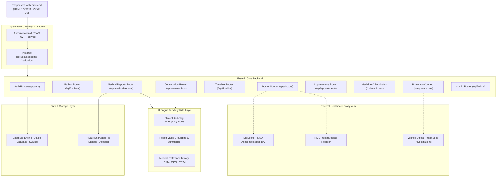

# System Architecture — AI Health Clinic

## High-Level Architecture Overview

## Architectural Principles
1. **Clinical Safety Decoupled from LLM**: Emergency signs (e.g. chest pain, stroke symptoms) are identified deterministically by the rule layer before any language model generation.
2. **Authoritative Timeline Synchronization**: The Unified Health Timeline is automatically synchronized when reports are uploaded, consultations concluded, or appointments scheduled.
3. **Multi-Tenant Data Isolation**: Patient medical records can never be traversed or accessed by altering URL IDs.
4. **Dual Database Adaptability**: Production deployments connect to Oracle Database (via `oracledb`) using parameterized queries; local development defaults to SQLite (`ai_health_clinic.db`) with zero manual setup.
